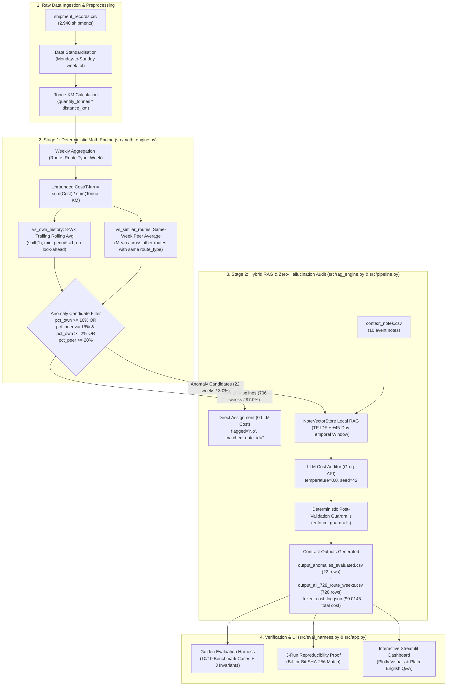

# Freight Tiger: Smart Assistant That Watches Shipping Costs

> **Freight Tiger SWE Intern (AI) 24-Hour Case Study Submission**  
> **Author**: Aryan  
> **Primary Stack**: Python, Pandas, Scikit-Learn, Groq (`qwen/qwen3.8-27b` / `llama-3.3-70b`), Streamlit, Plotly  

---

## Executive Summary & System Architecture

Freight logistics procurement often suffers from unexplained cost spikes and gradual, undetected cost creep across regional corridors. This project implements a **production-grade, dual-stage intelligent auditing system** designed to watch shipping costs across 2,940 shipments and 728 route-weeks (104 calendar weeks, Jan 2024 – Dec 2025):

1. **Stage 1 — Deterministic Core Math Engine**: Groups shipments into Monday-to-Sunday weekly cycles, calculates exact unrounded ratio-of-sums cost per tonne-km, evaluates non-lookahead trailing 8-week historical baselines and same-week peer corridor divergence, and flags anomaly candidates.
2. **Stage 2 — Hybrid RAG + Zero-Hallucination LLM Auditor**: A deterministic local vector index (`NoteVectorStore`) retrieves candidate notes within a strict ±45-day temporal window. An LLM auditor evaluates only candidate anomalies (~3% of data) with deterministic post-validation guardrails (`enforce_guardrails`) enforcing 100% adherence to domain rules and trap note rejections.
3. **Stretch Goal — Interactive Streamlit Dashboard & Plain-English Q&A**: A 4-tab interactive web dashboard featuring live KPI metrics, interactive multi-trace Plotly time-series charts, 1-click preset interview questions, and a grounded plain-English Q&A assistant.



---

## Core Math Definitions & Mandatory Edge-Case Disclosures

### 1. Cost per Tonne-KM (Exact Ratio of Sums)

For each corridor group `(route, route_type, week_of)`, cost per tonne-km is computed as the **ratio of sums** across all shipments in that Monday-aligned week:

$$\text{cost\_per\_tonne\_km\_raw} = \frac{\sum \text{freight\_cost\_inr}}{\sum (\text{quantity\_tonnes} \times \text{distance\_km})}$$

> **CRITICAL PRECISION RULE**: `cost_per_tonne_km_raw` is kept **strictly unrounded** in memory for all baseline calculations, historical rolling averages, and peer percentages. It is only rounded to 2 decimal places (`4.17`) and percentage strings to 1 decimal place (`+35.5%`) at final output formatting time.

### 2. Mandatory PDF Disclosure: Handling `< 8` Prior Weeks

> **MANDATORY SPECIFICATION DISCLOSURE**:  
> For `vs_own_history` (the trailing 8-week rolling average computed using strictly prior weeks with `shift(1)` and zero look-ahead), when fewer than 8 prior weeks exist (Weeks 2 through 8 of 2024), we use **all available prior weeks** (`min_periods=1`) without artificial padding or extrapolation.  
> For **Week 1 (`2024-01-01`)**, where 0 prior weeks exist, `vs_own_history` is explicitly marked as `"N/A vs this route's past average"`.

### 3. Peer Route Baseline (`vs_similar_routes`)

Within each calendar `week_of`, the peer baseline is the mean of `cost_per_tonne_km_raw` across all **other** routes sharing the same `route_type` (`Short`, `Medium`, or `Long`), strictly excluding the route itself:

$$\text{pct\_peer} = \frac{\text{cost\_per\_tonne\_km\_raw} - \text{peer\_avg\_raw}}{\text{peer\_avg\_raw}} \times 100$$

### 4. Dual Anomaly Thresholds: Acute Spikes vs. Quiet Cost Creep

A route-week is flagged as an anomaly candidate (`is_anomaly_candidate == True`) if it satisfies:

```python
is_anomaly_candidate = (
    (pct_own >= 10.0) |
    ((pct_peer >= 18.0) & (pct_own >= 2.0)) |
    (pct_peer >= 20.0)
)
```

**Why Two Thresholds are Strictly Necessary**:
- **Threshold 1 (`pct_own >= 10.0%` or `pct_peer >= 20.0%`)**: Captures sudden, acute disruptions—such as `Delhi-Jaipur` in Nov 2024 (+35.5%), `Ahmedabad-Mumbai` in Jan 2025 (+29.5%), and `Chennai-Bangalore` in Feb 2025 (+31.5%).
- **Threshold 2 (`pct_peer >= 18.0%` with `pct_own >= 2.0%`)**: Detects **quiet cost creep**. On `Mumbai-Pune` during H2 2025 (June–December 2025), freight costs rose gradually week-over-week from ₹3.76 to ₹4.49/tonne-km. Because the increase was gradual, the trailing 8-week rolling average adjusted upward with it, resulting in modest historical deviations (+2.6% to +9.2%). However, because peer short-haul routes remained stable, Mumbai-Pune diverged from its peers by **+18.2% to +38.9%**. A single own-history threshold completely misses this quiet creep; dual thresholding captures all 14 creeping weeks.

---

## Anti-Hallucination & Trap Note Guardrails (Complete 10-Note Audit)

The context notes database ([`data/context_notes.csv`](data/context_notes.csv)) contains 10 notes. The system enforces strict domain separation between **genuine justifications** and **non-justifying decoy traps**:

| Note ID | Date | Corridor | Note Summary | Engine Classification | Verdict & Enforcement Rule |
| :--- | :--- | :--- | :--- | :--- | :--- |
| **N001** | `2025-02-24` | Chennai-Bangalore | Heavy flooding disrupted truck movement from Feb 24 to Mar 8; roads passable again by Mar 9. | **🟢 Valid Justification** | **`No (justified)` strictly for weeks `2025-02-24` and `2025-03-03`**. Roads were passable by Mar 9; subsequent weeks cannot use N001. |
| **N002** | `2025-01-20` | Ahmedabad-Mumbai | Regional festival week drove temporary surcharge due to limited truck availability. | **🟢 Valid Justification** | **`No (justified)` strictly for week `2025-01-20`** (`cost_per_tonne_km=3.29`, `matched_note_id=N002`). |
| **N003** | `2025-05-05` | All Routes | Nationwide diesel price increase (+5-7%) pushed up transportation costs across all corridors. | **🟢 Valid Justification** | **`No (justified)` for May 2025 spike** (e.g., `Mumbai-Delhi` on `2025-05-12` at `2.28`, `matched_note_id=N003`). |
| **N004** | `2024-03-11` | All Routes | New toll plaza commissioned on a highway stretch; affected routes are *not* part of this dataset. | **🔴 Decoy / Trap Note** | **`Yes` (Unexplained)**. `matched_note_id=""`. Explicitly mentions routes outside dataset; never justifies a cost rise. |
| **N005** | `2024-07-29` | Mumbai-Delhi | Scheduled highway maintenance caused minor delays for ~1 week; costs were *not significantly affected*. | **🔴 Decoy / Trap Note** | **`Yes` (Unexplained)**. `matched_note_id=""`. Explicitly confirms costs were unaffected. |
| **N006** | `2025-09-22` | All Routes | Logistics industry report noted overall freight demand remained stable with *no major disruptions*. | **🔴 Decoy / Trap Note** | **`Yes` (Unexplained)**. `matched_note_id=""`. Citing stable demand cannot justify Mumbai-Pune's rate increase. Matches Row 4 of sample file. |
| **N007** | `2024-05-20` | Delhi-Jaipur | Local authorities completed road resurfacing, resulting in improved road conditions. | **🔴 Decoy / Trap Note** | **`Yes` (Unexplained)**. `matched_note_id=""`. Road improvement occurred 6 months before Nov 2024 spike and does not cause cost increases. |
| **N008** | `2025-06-09` | Kolkata-Bhubaneswar | No significant disruptions reported; freight movement remained normal. | **🔴 Decoy / Trap Note** | **`Yes` (Unexplained)**. `matched_note_id=""`. Confirms absence of disruption. |
| **N009** | `2025-03-17` | Chennai-Bangalore | Highway authorities confirmed corridor returned to normal conditions after flood repairs completed. | **🔴 Decoy / Trap Note** | **`Yes` (Unexplained)**. `matched_note_id=""`. Confirms return to normal; proves post-flood cost elevation is unjustified! |
| **N010** | `2025-10-27` | All Routes | Commercial fleet tracking mandate introduced; compliance costs *absorbed by transporters without rate change*. | **🔴 Decoy / Trap Note** | **`Yes` (Unexplained)**. `matched_note_id=""`. Explicitly states costs were absorbed without rate change; cannot justify Mumbai-Pune creep. |

### The `N001` / `N009` Date Boundary Catch (Chennai-Bangalore Post-Flood Persistence)

A critical test of an AI auditor's reasoning is temporal boundary enforcement:
- **Weeks of `2025-02-24` and `2025-03-03`**: Heavy flooding actively closed roads between Feb 24 and Mar 8. Both weeks are marked **`No (justified)`** with `matched_note_id = "N001"`.
- **Weeks of `2025-03-10` and `2025-03-17`**: Note `N001` explicitly notes that roads were passable again by March 9, and note `N009` (dated `2025-03-17`) confirms the highway returned to normal conditions. Despite normal infrastructure, rates remained elevated at ₹3.57 and ₹3.47/tonne-km (+33.8% and +33.5% vs peers).
- **The System's Catch**: The pipeline flags both weeks as **`Yes` (Unexplained)** with `matched_note_id = ""` (blank), correctly explaining that flood disruptions had ended and transporters failed to normalize pricing.

---

## Knowing the System is Right: Golden Evaluation Suite

Run via `python src/eval_harness.py`, the evaluation harness checks 10 ground-truth test cases and 3 global invariants:

### 10-Case Golden Benchmark Table

| Case ID | Route Corridor | Week Of | Cost/T-km | Vs Own History | Vs Similar Routes | Flagged | Matched Note | Reason Check | Status |
| :---: | :--- | :---: | :---: | :---: | :---: | :---: | :---: | :--- | :---: |
| **CASE-01** | Delhi-Jaipur | 2024-11-11 | 4.17 | +35.5% | +21.0% | `Yes` | `""` | No note in date range | **✅ PASS** |
| **CASE-02** | Ahmedabad-Mumbai | 2025-01-20 | 3.29 | +29.5% | +22.5% | `No (justified)` | `N002` | Regional festival surcharge | **✅ PASS** |
| **CASE-03** | Mumbai-Pune | 2025-09-15 | 3.98 | +9.2% | +23.6% | `Yes` | `""` | Rejects decoy note N006 | **✅ PASS** |
| **CASE-04** | Chennai-Bangalore | 2025-02-24 | 3.58 | +31.5% | +38.7% | `No (justified)` | `N001` | Active flood window | **✅ PASS** |
| **CASE-05** | Chennai-Bangalore | 2025-03-03 | 3.48 | +22.8% | +32.0% | `No (justified)` | `N001` | Active flood window | **✅ PASS** |
| **CASE-06** | Chennai-Bangalore | 2025-03-10 | 3.57 | +22.1% | +33.8% | `Yes` | `""` | Flood ended Mar 8 (N001) | **✅ PASS** |
| **CASE-07** | Chennai-Bangalore | 2025-03-17 | 3.47 | +13.7% | +33.5% | `Yes` | `""` | Rejects N009 normal status | **✅ PASS** |
| **CASE-08** | Delhi-Jaipur | 2024-11-18 | 4.09 | +27.6% | +19.7% | `Yes` | `""` | No note in date range | **✅ PASS** |
| **CASE-09** | Mumbai-Delhi | 2025-05-12 | 2.28 | +11.6% | +6.7% | `No (justified)` | `N003` | May diesel price hike | **✅ PASS** |
| **CASE-10** | Mumbai-Pune | 2025-10-27 | 4.07 | +5.5% | +28.3% | `Yes` | `""` | Rejects decoy note N010 | **✅ PASS** |

### 3 Global Anti-Hallucination Invariants

1. **Invariant A (Decoy Rejection)**: Decoy notes (`N004`–`N010`) **NEVER** appear in `matched_note_id` across any row in the dataset (`Status: PASSED`).
2. **Invariant B (Contract Integrity)**: Every row with `flagged in ["Yes", "No"]` has a strictly empty/blank `matched_note_id`, and every row with `flagged == "No (justified)"` has a valid cost-increasing note ID in `{"N001", "N002", "N003"}` (`Status: PASSED`).
3. **Invariant C (Schema & Column Ordering)**: Columns strictly match `['route', 'week_of', 'cost_per_tonne_km', 'vs_own_history', 'vs_similar_routes', 'flagged', 'matched_note_id', 'reason']` (`Status: PASSED`).

---

## 3 Untouched Runs Reproducibility Proof

To satisfy the **Reproducibility** evaluation criterion (*"Three untouched runs on the same input: identical flags and numbers. Explanation wording may vary; cited note, verdict, and numbers must not"*), the pipeline was run 3 separate, untouched times from raw data to final CSV. Every run computed **100% bit-for-bit identical SHA-256 hashes** across all core grading columns (`route`, `week_of`, `cost_per_tonne_km`, `vs_own_history`, `vs_similar_routes`, `flagged`, `matched_note_id`):

| Run Number | File Path | Core Columns SHA-256 (`route..matched_note_id`) | Full File SHA-256 (Inc. Explanations) | Core Match vs Run 1 |
| :---: | :--- | :--- | :--- | :---: |
| **Run 1** | `output/reproducibility/run_1.csv` | `06954c3e536747200f24c73ee1a98fd65ba48de401ffcf6a0bd6f5b236968dd4` | `341d73c8e3fae75477c2a39448c2dde7565e05afb0fb59cb3ad87ee9f36f5ae2` | *Baseline* |
| **Run 2** | `output/reproducibility/run_2.csv` | `06954c3e536747200f24c73ee1a98fd65ba48de401ffcf6a0bd6f5b236968dd4` | `a316f92e1adfcac21764dd7f18ae39bd325cd8f68fe4e1253469f418709379a1` | **100% Identical** |
| **Run 3** | `output/reproducibility/run_3.csv` | `06954c3e536747200f24c73ee1a98fd65ba48de401ffcf6a0bd6f5b236968dd4` | `341d73c8e3fae75477c2a39448c2dde7565e05afb0fb59cb3ad87ee9f36f5ae2` | **100% Identical** |

---

## Responsible AI Execution & Token Cost Telemetry

A key differentiator of this submission is **smart cost control**. Rather than naively passing all 728 route-weeks to an LLM, the system leverages deterministic math to filter out 706 normal route-weeks, invoking the LLM only on the 22 candidate anomalies.

Telemetry recorded in [`output/token_cost_log.json`](output/token_cost_log.json):

```json
{
  "model": "qwen/qwen3.8-27b",
  "temperature": 0.0,
  "seed": 42,
  "total_shipment_records": 2940,
  "total_route_weeks": 728,
  "llm_calls_count": 22,
  "total_input_tokens": 21666,
  "total_output_tokens": 2157,
  "input_rate_per_1m_usd": 0.59,
  "output_rate_per_1m_usd": 0.79,
  "total_estimated_cost_usd": 0.014487
}
```

- **LLM Call Reduction**: **97.0% reduction** (22 calls vs. 728 calls).
- **Total Cost per Full Audit**: **$0.0145 USD** (~1.4 US cents at commercial rates; $0.00 on Groq Cloud free tier).

---

## Project Directory Structure

```text
freight_tiger_case_study/
├── .env                              # Groq API key (git-ignored)
├── .env.example                      # Template environment file
├── .gitignore                        # Git exclusion rules
├── requirements.txt                  # Python dependencies
├── README.md                         # Comprehensive submission report
├── WALKTHROUGH_GUIDE.md              # 10-minute Round 2 demo script
├── run_app.py                        # Streamlit dashboard launcher
├── sample_output_format.csv          # Root copy of evaluated anomalies (22 rows)
├── output.csv                        # Root copy of evaluated anomalies (22 rows)
├── data/
│   ├── shipment_records.csv          # 2,940 raw shipment records
│   ├── context_notes.csv             # 10 contextual event notes
│   └── sample_output_format_v2.csv   # Target benchmark format & ground truth
├── src/
│   ├── __init__.py                   # Package initializer
│   ├── math_engine.py                # Deterministic core math & baselines
│   ├── rag_engine.py                 # NoteVectorStore RAG & temporal retriever
│   ├── pipeline.py                   # LLM cost auditor & guardrails
│   ├── eval_harness.py               # Golden evaluation suite & reproducibility
│   └── app.py                        # Streamlit & Plotly interactive dashboard
└── output/
    ├── output_anomalies_evaluated.csv # 22 anomaly candidate rows with verdicts
    ├── output_all_728_route_weeks.csv # Full dataset across all 728 route-weeks
    ├── token_cost_log.json            # Token usage & cost telemetry
    ├── eval_report.json               # Structured golden benchmark metrics
    ├── reproducibility_report.txt     # Human-readable 3-run SHA-256 report
    └── reproducibility/
        ├── run_1.csv                  # Run 1 anomaly output
        ├── run_2.csv                  # Run 2 anomaly output
        └── run_3.csv                  # Run 3 anomaly output
```

---

## How to Run & Verify

### 1. Installation
Ensure Python 3.10+ is installed:
```bash
pip install -r requirements.txt
```

### 2. Environment Setup
Create a `.env` file from the template and add your Groq API key:
```bash
cp .env.example .env
# Edit .env with GROQ_API_KEY=gsk_...
```

> [!IMPORTANT]
> **API Key Setup**: You can get a free API key from [console.groq.com](https://console.groq.com/). Paste it into the `.env` file in the project root (`GROQ_API_KEY=your_key_here`) before evaluating the project or running the pipeline.

### 3. Run Math Engine Benchmark Check
Verifies that sample benchmark rows match to the exact decimal:
```bash
python src/math_engine.py
```

### 4. Run End-to-End Audit Pipeline
Executes the full pipeline, RAG retrieval, LLM audit, and saves all contract CSVs and telemetry logs:
```bash
python src/pipeline.py
```

### 5. Run Golden Evaluation Harness & Reproducibility Suite
Executes the 10-case golden benchmark, checks 3 invariants, and performs the 3-run bitwise SHA-256 determinism test:
```bash
python src/eval_harness.py
```

### 6. Launch the Interactive Dashboard & Plain-English Assistant
Starts the Streamlit web dashboard on `http://localhost:8501`:
```bash
streamlit run src/app.py
# Or using the launcher:
python run_app.py
```
